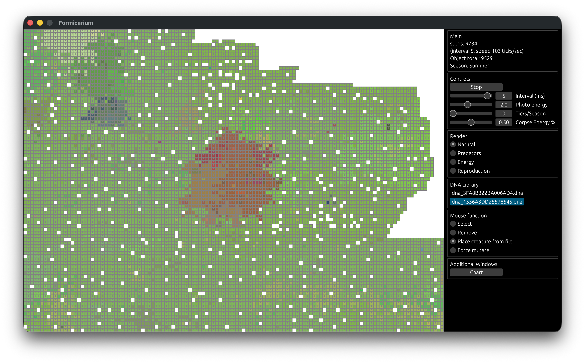

# Formicarium

**An open-source artificial life simulation and neuroevolution sandbox built in Rust.**

[](https://opensource.org/licenses/MIT)



Formicarium is a high-performance ALife simulation where autonomous agents (ants) evolve to survive in a harsh, seasonal environment. Instead of hardcoded behaviors, agents are driven by custom graph-based neural networks (inspired by NEAT) that mutate and evolve over generations. The project features a real-time multithreaded GUI and a "God Mode" sandbox for saving, loading, and injecting specific genomes into the world.

## Features

- **Neuroevolution Engine:** Custom graph-based neural networks with structural mutations, biases, and activation functions.
- **Complex Ecology:** Herbivores, predators, and photosynthesizers competing for energy. Kinship recognition based on genetic tags.
- **Advanced Genetics:** Custom binary DNA serialization format for saving/loading brains. Budding and Mitosis reproduction strategies.
- **Harsh Environment:** Dynamic season system (Spring, Summer, Autumn, Winter) affecting food availability.
- **Multithreaded Architecture:** Simulation and GUI run in separate threads, communicating via atomic configs and a command queue.
- **Interactive Sandbox:** Select agents to inspect their stats, spawn saved DNA from files, force mutations, or instantly remove agents.
- **Data Visualization:** Real-time population charts and advanced Hamming-weight-based color mapping for visual kinship recognition.

## Getting Started

### Prerequisites

- [Rust & Cargo](https://rustup.rs/) (latest stable version)

### Setup

```bash
git clone https://github.com/Artem-Metnil/formicarium.git
cd formicarium
cargo run --release
